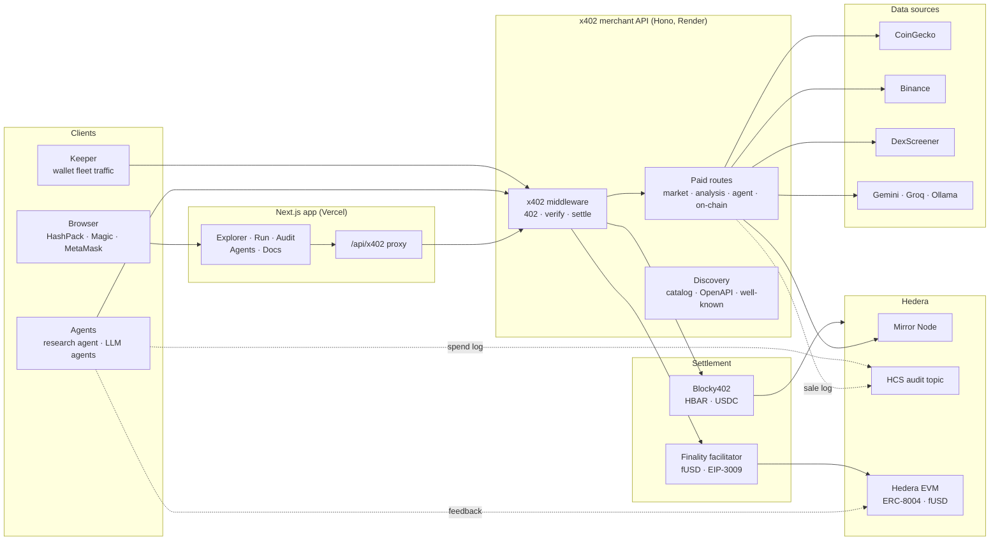
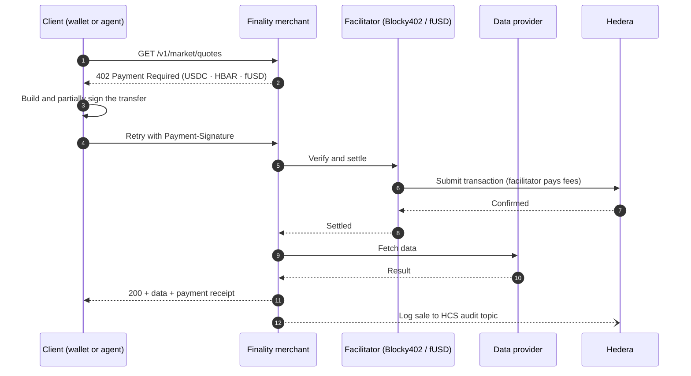

<div align="center">


# Finality

**Pay-per-request market data and intelligence for people and AI agents, settled on Hedera.**

No accounts, no API keys, no subscriptions. Call an endpoint, pay for that one request over [x402](https://www.x402.org), get your data.

[**Live app**](https://finality-seven.vercel.app/) · [**API**](https://finality-x402-backend.onrender.com/info) · [**Catalog**](https://finality-x402-backend.onrender.com/v1/catalog) · [**OpenAPI**](https://finality-x402-backend.onrender.com/v1/openapi.json)


</div>

---

## Contents

- [Why Finality](#why-finality)
- [Architecture](#architecture)
- [How a paid request works](#how-a-paid-request-works)
- [Features](#features)
- [API overview](#api-overview)
- [Project structure](#project-structure)
- [Getting started](#getting-started)
- [Agents](#agents)
- [Testing](#testing)
- [Deployment](#deployment)
- [Security](#security)
- [Tech stack](#tech-stack)

## Why Finality

Data APIs are built for humans with credit cards: sign up, get a key, pick a plan. Autonomous agents can't do any of that. Finality gives agents and people the same simple deal: every endpoint has a price, and the payment travels with the request.

- **Pay per call** in HBAR, USDC (HTS) or fUSD on Hedera EVM. The 39 paid endpoints cost $0.10 to $4.00 per call.
- **Discoverable by machines.** The catalog, OpenAPI spec, `/.well-known/x402` and `llms.txt` tell an agent what exists and what it costs.
- **Verifiable.** Each sale is logged to the Hedera Consensus Service, and agents rate the merchant on-chain through ERC-8004.
- **Honest data.** On-chain answers come straight from the Mirror Node. Any fallback data is labelled as synthetic.

## Architecture



**The pieces:**

| Component | Role |
| --- | --- |
| **Next.js app** | The UI people use. It talks to the merchant through a same-origin proxy (`/api/x402/*`) that strips cookies and auth headers. Wallets sign in the browser, so the app never sees a private key. |
| **x402 merchant** | The public API and source of truth. Middleware returns `402`, checks the payment with a facilitator, then runs the operation. |
| **Facilitators** | Blocky402 settles HBAR and USDC and pays network fees. Finality's own facilitator settles fUSD on Hedera EVM and pays gas only for the merchant's payee. |
| **Providers** | Adapters for CoinGecko, Binance, DexScreener and the Mirror Node behind one data format, with caching and timeouts. LLM routes use Gemini, Groq or Ollama. |
| **Agents** | A rule-based research agent and LLM agents on Hedera Agent Kit. Both discover, pay under a spend policy, log spends to HCS and rate the merchant. |
| **Keeper** | A standalone service that funds a fleet of wallets and makes realistic paid traffic. |

## How a paid request works



Provider calls only happen after settlement, so an unpaid request never costs anything upstream.

## Features

**For people**
- Connect with HashPack (WalletConnect), a Magic email wallet, or MetaMask on Hedera EVM (chain 296)
- Browse providers and endpoints, run any paid call from the browser and see the receipt
- Live audit feed, transaction history and the ERC-8004 identity panel
- Interactive API docs at `/docs`

**For agents**
- Machine-readable catalog with prices, limits, examples and operation IDs
- `/.well-known/x402`, `agent.json`, `agent-card.json`, `ai-plugin.json`, `llms.txt`, `agents.md`
- Spend policy: total budget, per-call and per-merchant caps, payee allowlist, human approval above a threshold

**On-chain**

| Piece | Where |
| --- | --- |
| HCS audit trail | The merchant logs every sale and the agent logs every spend, with the same response hash. Shown at `/explore/audit`. |
| ERC-8004 identities | Finality is agent **#144** and the research agent is **#145** in the shared registries on Hedera EVM. |
| fUSD (EIP-3009) | `0x8Bb1d3aa637A54859dcC772EB01fE45eEECE482f` on Hedera testnet. |
| HCS-11 profile | The intelligence agent has its own account and HCS-11 profile. |

## API overview

Base URL: `https://finality-x402-backend.onrender.com`

**Free**

| Route | What it returns |
| --- | --- |
| `GET /health` | Component health and configured modes |
| `GET /info` | Service info, payment rails, discovery links |
| `GET /v1/catalog` | Every endpoint with its price, limits and examples |
| `GET /v1/openapi.json` | OpenAPI 3.1 spec |
| `GET /v1/audit/recent` | Recent HCS audit entries |
| `GET /v1/erc8004/merchant` · `/v1/erc8004/agents/:id` | Identity and reputation |

**Paid**

| Group | Endpoints |
| --- | --- |
| Market | `/v1/market/quotes` · `assets` · `candles` · `trending` · `categories` · `fear-greed` · `token-prices` |
| Analysis | `/v1/technicals` · `/v1/signals` · `/v1/backtest` · `/v1/analysis/report` · `volume` · `events` |
| Agent tools | `/v1/agent/briefing` · `/v1/agent/decision` · `/v1/agent/strategy/parse` · `/v1/ai/chat` |
| Hedera on-chain | `/v1/onchain/hedera/account` · `balances` · `token` · `transaction` · `topic` · `blocks` · `network/supply` · `network/nodes` |

Try it:

```bash
curl -i https://finality-x402-backend.onrender.com/v1/market/quotes
# HTTP/1.1 402 Payment Required
# Payment-Required: <base64 payment requirements>
```

## Project structure

```
.
├── app/                 Next.js routes: landing, /explore/*, /docs, /api/x402 proxy
├── components/          UI, wallet button, dashboard, agents view
├── lib/                 Shared code: hedera, evm, x402, providers, discovery
├── x402-server/         Hono merchant API
│   ├── middleware/      x402 payment, limits, errors, request context
│   ├── routes/          market, intelligence, ai, agents, onchain, audit, erc8004, public
│   ├── services/        operation runner with provider fallbacks
│   └── tests/           payments, endpoints, contract and agent tests
├── facilitator/         Finality's x402 facilitator for fUSD on Hedera EVM
├── contracts/           FinalityUSD.sol, compile script, deployments
├── agent/               Rule-based research agent and MerchantSession
├── agents/              LLM agents (core, plugins, specs, bench, registry)
├── keeper/              Wallet fleet and traffic loop (own README)
├── scripts/             Wallets, deploys, HCS topic, ERC-8004, smoke tests
└── docs/                Status report, settlements, agent runs, benchmarks
```

## Getting started

**You need:** Node.js 20+, a Hedera testnet account to receive payments, and a [WalletConnect](https://cloud.reown.com) project ID.

```bash
git clone https://github.com/mdmudassir0143/Finality.git
cd Finality
npm install
cp .env.example .env
```

Set at least these in `.env`:

| Variable | Purpose |
| --- | --- |
| `X402_PAYTO_ADDRESS` | Hedera account that receives payments |
| `NEXT_PUBLIC_WALLETCONNECT_PROJECT_ID` | Lets HashPack connect |
| `X402_FACILITATOR_URL` | Defaults to Blocky402 testnet |
| `GEMINI_API_KEY` | Optional, for AI routes and LLM agents |

Every other variable is documented in [`.env.example`](.env.example). One `.env` file covers the merchant, the scripts and the frontend, and `x402-server/.env` can override merchant values.

**Run it:**

```bash
npm run dev:all          # merchant on :4021 + frontend on :3000
npm run dev:merchant     # merchant only
npm run dev:frontend     # frontend only
npm run dev:facilitator  # optional fUSD facilitator on :4022 (needs FACILITATOR_EVM_KEY)
```

**Optional on-chain setup:**

```bash
npm run hcs:create-audit-topic         # then set HCS_AUDIT_TOPIC_ID
npm run erc8004:register -- merchant   # or: -- agent
npm run fusd:compile && npm run fusd:deploy
npm run check:discovery                # check the discovery documents
```

## Agents

```bash
npm run agent                                                    # rule-based research agent
npm run agents -- list
npm run agents -- run intelligence --goal "How is HBAR doing today?"
npm run agents -- bench intelligence                             # writes docs/BENCHMARKS.md
```

A run looks like this: read the catalog → plan calls → check each one against the spend policy → pay → log the spend to HCS → leave ERC-8004 feedback → write a cited answer. If a call breaks the policy, it never gets paid.

More detail: [`docs/AGENTS_TRACKER.md`](docs/AGENTS_TRACKER.md), [`docs/AGENT_RUNS.md`](docs/AGENT_RUNS.md), [`docs/BENCHMARKS.md`](docs/BENCHMARKS.md). The keeper has its own guide in [`keeper/README.md`](keeper/README.md).

## Testing

```bash
npm run test:x402          # merchant, middleware, contract and agent tests (Vitest)
npm run test:wallet:e2e    # wallet end-to-end
npm run test:x402:testnet  # real paid call on testnet (needs X402_TEST_PAYER_*)
npm run test:x402:evm      # real fUSD paid call
npx tsc --noEmit
```

Real settlements made during testing are recorded in [`docs/SETTLEMENTS.md`](docs/SETTLEMENTS.md).

## Deployment

| Service | Host | How |
| --- | --- | --- |
| Frontend | Vercel | `vercel.json`. Live at [finality-seven.vercel.app](https://finality-seven.vercel.app/) |
| Merchant API | Render | `npm run build:x402` then `npm run start:x402` |
| Keeper | Render | Defined in `render.yaml` |

## Security

- The merchant never stores a private key or a raw signed payment. Wallets and agents sign on their own side.
- The frontend proxy strips cookies, auth and hop-by-hop headers, and rejects `.`/`..` path segments.
- Inputs, body size, request rate, concurrency and provider timeouts are all limited.
- The fUSD facilitator uses its own gas wallet, never the merchant key, and only pays gas for the merchant's payee.
- The server warns on startup if `X402_PAYTO_ADDRESS` is unset or still the `0.0.0` placeholder.
- On-chain responses report Mirror Node data only. If a market or AI provider fails, the response falls back to sample data labelled as synthetic.

## Tech stack

| Layer | Tools |
| --- | --- |
| Frontend | Next.js 16, React 19, Tailwind CSS, Hedera WalletConnect, Magic, viem |
| Merchant | Hono 4, TypeScript, x402 |
| Hedera | Hashgraph SDK, Mirror Node, HCS, Hedera EVM (chain 296) |
| Agents | Hedera Agent Kit v4, Vercel AI SDK, Gemini |
| Contracts | Solidity (fUSD, EIP-3009), ERC-8004 registries |
| Testing | Vitest |
